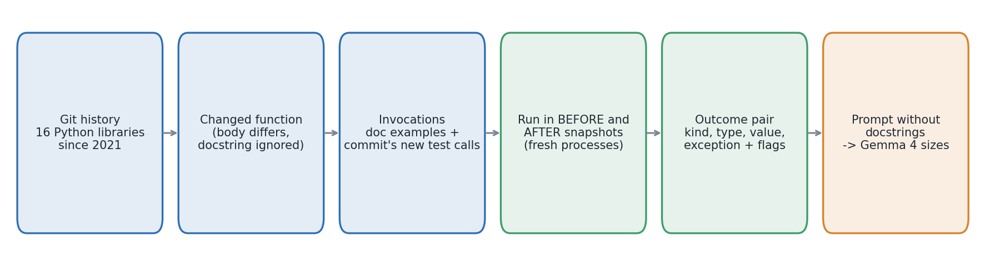
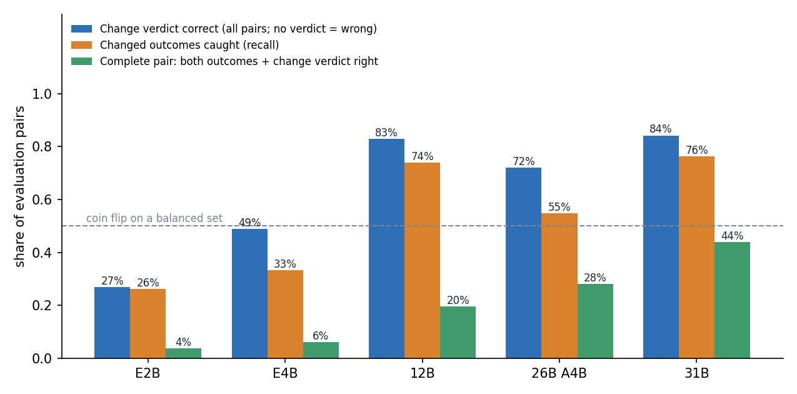
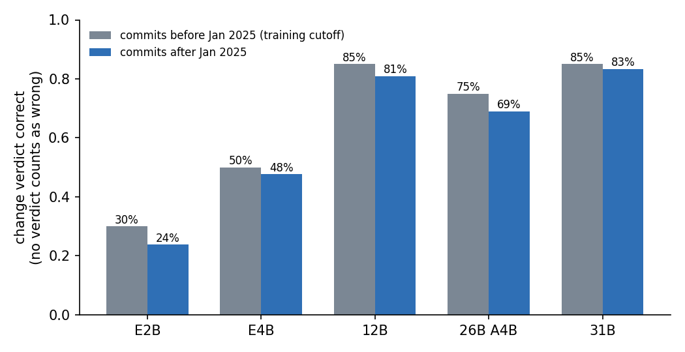
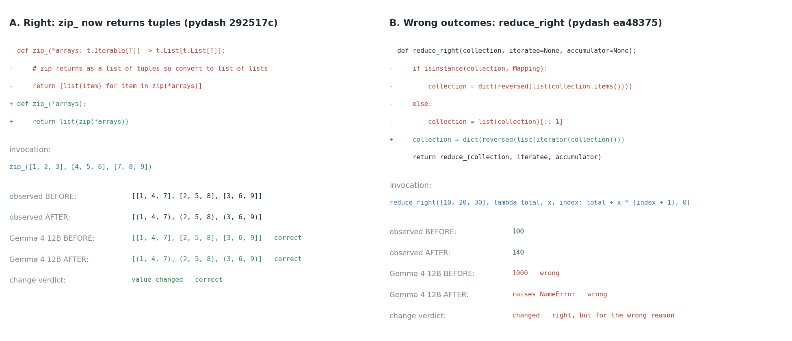

## Abstract

A coding agent that has found the right function still has to answer a harder question: *what does this call return now that the code has changed?* We release **VersionOutcomes**, a resource of real before/after outcomes of Python function calls across library commits, and use it to measure the whole Gemma 4 family. A new rule-mined set covers 16 libraries with no hand selection: every function whose body changed in a commit since 2021 is run, in both the parent and the commit snapshot, on its documentation examples and on the calls in that commit's new regression tests. This yields 1,973 executed outcome pairs; we evaluate a balanced 82 (42 changed, 40 unchanged; 11 libraries; half from commits after Gemma 4's January 2025 training cutoff), with docstrings removed from the prompt. Detecting *that* behaviour changed is within reach of local models: on this balanced set, Gemma 4 12B detected 31 of 42 changes with two false alarms, and 31B detected 32 with three. Predicting *what* the new behaviour is was harder under our prompts, which show only the changed function and sometimes omit helpers the outcome depends on: even 31B gets both outcomes and the change verdict right on only 36 of 82 pairs, and the new outcome on 26 of the 42 changed pairs. Giving the 12B model the observed output of the old version does not close the gap on changed pairs (19 to 20 of 42). Every number can be recomputed from the saved raw answers with the released scorer. A curated 42-pair set with call-frame evidence, released earlier, is kept as the instrumented companion. All sources, outcomes, prompts, raw answers and scripts are released.

## 1. Introduction

Repository-level agents are judged on whether they fix issues, but every fix is a behavioural prediction: after this edit, this call should return that. Agents also review diffs, bisect regressions and decide whether a refactor is safe. All of these need one skill: given two versions of a function and a concrete call, say what each version does and whether the result changes.

Finding the function and reasoning about its change are different skills. In our data the function name and signature often stay the same while the outcome changes: `zip_` starts returning tuples instead of lists, a bounds check turns an `IndexError` into `-1`, an empty input stops dividing by zero (Figure 2). Benchmarks that score retrieval or whole-patch correctness do not isolate this step, and they do not say whether a small local model's mistakes are about noticing a change or about working out its effect.

We contribute:

1. **A rule-mined resource of real version-change outcomes** (Figure 1): changed functions from 16 libraries' histories, executed on their documented examples and on their commits' own regression-test calls, with no case selection.
2. **A field-level protocol** that asks for both outcomes and the change verdict and scores kind, type, value and exception separately, so missed changes, wrong values and formatting failures are distinguishable.
3. **Measurements of all five Gemma 4 sizes** on consumer hardware and free Kaggle GPUs, with three controls: docstrings stripped (their examples contain expected outputs), a pre/post training-cutoff split, and an execution-grounded condition that shows the model the old outcome.

*Figure 1. How the rule-mined set is built: changed functions from Git history are run on their doc examples and the commit's new test calls in both snapshots.*

## 2. Related work

Runtime-labelled code reasoning is established: RepoReasoner [1] predicts repository outputs and call chains from execution records, and TraceEval [2] builds benchmarks from execution-covered call graphs. Version-aware behaviour analysis is also established: DCI [3] detects behavioural differences in real commits by varying tests, TEBench [4] studies test evolution after code changes, and RustEvo [5] evaluates adaptation to API evolution. SWE-bench [6] grades patches with fail-to-pass tests from real fixes. Our resource isolates the single-invocation, two-version outcome question, records the observed answer for both versions, and draws its inputs from the same commits' regression tests and documentation. We make no first-benchmark claim; the contribution is the paired records, the protocol and the measurements.

## 3. The resource

### 3.1 Rule-mined set

- **Libraries:** 16 pure-Python libraries with active histories (pydash, tabulate, natsort, tomlkit, pyparsing, semver, cachetools, python-slugify, sqlparse, funcy, Python-Markdown, glom, sortedcontainers, parse, inflection, jmespath). None overlaps the curated set.
- **Changes:** every non-merge commit since 2021-01-01; every top-level function or method whose body (docstring excluded) differs between parent and commit: 733 changed functions.
- **Invocations:** the doctest examples in the function's docstring, run in order in the module's namespace as `doctest` does, plus every call to the function on lines the same commit added to test files.
- **Execution:** both snapshots are exported from Git and run in fresh processes (Python 3.13.3, hash seed 0, 20 s limit). Each call records kind, fully qualified type, `repr` (or printed output when the value is `None`), and exception class, with memory addresses normalised. Snapshots that fail to import (44 of 733 functions, mostly a missing optional dependency) and calls that fail with `NameError`/`ImportError` are dropped as setup artefacts.

This yields 1,973 executed outcome pairs, 60 of which change. The two input sources behave very differently: documentation examples change outcome in 26 of 1,863 pairs (1.4%), while calls from the commit's new regression tests change in 34 of 110 (31%). Documented behaviour is kept stable; the tests that accompany a commit point at what it changed.

**Evaluation set.** We deduplicate identical pairs, keep at most three invocations per changed function, and take every changed pair plus an equal random sample of unchanged pairs per library (seed 42): 82 pairs, 42 changed and 40 unchanged, from 11 libraries; 42 come from commits after January 2025. In 21 of the 42 changed pairs every field changes (typically an exception becomes a return value or the reverse); in 14 only the value changes.

### 3.2 Prompt and scoring

The prompt gives the module and function name, the BEFORE and AFTER source of the function with docstrings removed, the earlier example lines of the same docstring as setup, and the invocation. The model returns JSON with both outcomes and four change flags. Scoring rules were fixed before any model output: kind exact; type and exception match the fully qualified or bare name; value matches the `repr` exactly or after literal evaluation (numbers within 1e-9). A phase is complete when all four fields match. The change verdict is binary: the answer says the outcome changed if any of its four change flags is true, and says unchanged otherwise. A **complete pair** requires both complete outcomes *and* the correct binary change verdict. An answer with no parseable JSON object carrying the change flags gives no verdict and scores zero on every measure; it is never counted as "unchanged".

### 3.3 Curated set (released earlier)

Forty-two input pairs from 13 commits in more-itertools, Boltons, Toolz, Humanize and Packaging keep runtime values, root-returned types, exceptions and profiler call frames; source bytes are pinned to Git blob IDs and all 102 worker records were re-observed on Windows and Linux. It shows that call-graph change is not a proxy for behaviour change: 16 value changes keep the same observed call targets. On its 21-pair held-out project cohort, Gemma 4 12B answered 2 of 21 paired questions completely under the original protocol (3 and 4 of 21 with a required-field schema and extra source providers on the same known cases).

## 4. Results

All runs use Google's official Gemma 4 QAT Q4_0 GGUF weights, llama.cpp at the same pinned commit (b11552), thinking off, temperature 0 and seed 42, at most 1,536 output tokens. The 12B runs on a local RTX 5070 Ti (Windows); the other four sizes run in one free Kaggle T4 x2 session (Linux).

### 4.1 Detecting change versus predicting outcomes

| Gemma 4 (82 pairs, 42 changed) | E2B | E4B | 12B | 26B A4B | 31B |
|---|---:|---:|---:|---:|---:|
| Valid JSON answers | 36 | 57 | 82 | 82 | 82 |
| No change verdict (scored wrong) | 55 | 28 | 1 | 0 | 0 |
| Change verdict correct | 22 | 40 | 68 | 59 | 69 |
| Changes detected (of 42) | 11 | 14 | 31 | 23 | 32 |
| False alarms (of 40 unchanged) | 1 | 1 | 2 | 4 | 3 |
| Exact BEFORE value | 5 | 20 | 32 | 40 | 54 |
| Complete AFTER outcome | 4 | 13 | 27 | 36 | 46 |
| New outcome right on changed pairs | 1/42 | 7/42 | 19/42 | 21/42 | 26/42 |
| **Complete pair** | **3** | **5** | **16** | **23** | **36** |

*Figure 3. Change verdict, recall and complete pairs by Gemma 4 size (82 pairs, 42 changed). Answers without a change verdict count as wrong.*

Two skills scale differently (Figure 3). Change detection is strong from 12B: 12B detected 31 of 42 changes with two false alarms (verdict right on 68 of 82), and 31B detected 32 with three (69 of 82). Exact outcomes keep improving with size: complete pairs rise from 3 to 5, 16, 23 and 36. Even the largest model predicts the new outcome for only 26 of the 42 real changes; part of this is the prompt, which shows only the changed function (Section 4.4). The two smallest models mostly fail on format: E2B gives no usable verdict on 55 of 82 items and E4B on 28, mostly because the answer is not valid JSON (they often run out of tokens while restating code). Scored as wrong, these put E2B and E4B below a coin flip on the verdict, so their numbers measure output format as much as reasoning. The 26B A4B mixture-of-experts model is better than 12B at values but worse at the change verdict (23 of 42 detected).

### 4.2 Does seeing the old behaviour help?

An agent can usually run the old code before reasoning about a change. We gave Gemma 4 12B the observed BEFORE outcome and asked the same question. Complete pairs jump from 16 to 57 of 82, but nearly all of the gain is in unchanged pairs, where the old answer can be copied. On the 42 changed pairs, the new outcome is right in 20 (was 19), exact values in 22 (was 20) and detected changes in 34 (was 31). **Execution grounding makes the unchanged half trivial and leaves the changed half where it was**: the model knows something changed but cannot work out what the change does to this input.

### 4.3 Training-cutoff split (preliminary check)

Commits after January 2025 should not be in Gemma 4's pre-training data. As a preliminary check, we split the set by commit date (40 pairs before, 42 after). Change-verdict accuracy is similar on both sides for the two strongest models (12B 85% vs 81%, 31B 85% vs 83%; Figure 4), which does not suggest that detection depends on memorised commits. Complete pairs are lower after the cutoff (12B 25% vs 14%, 31B 48% vs 40%). With about 40 pairs per side, neither difference is statistically meaningful; a larger post-cutoff set is needed before drawing conclusions about contamination.

*Figure 4. Preliminary check: change-verdict accuracy on commits before (40 pairs) and after (42 pairs) Gemma 4's January 2025 training cutoff. Answers without a verdict count as wrong.*

### 4.4 Where the errors are

For Gemma 4 12B on the 42 changed pairs: 11 changes are missed outright; 9 are fully right; 9 get the new outcome right but the old one wrong; 7 get kind and type right with a wrong value; 5 get the type or exception wrong; 1 gets the kind (return versus raise) wrong. Figure 2B shows a typical failure: the model correctly says `reduce_right` changed, but predicts 1000 before and a `NameError` after, where the code returns 100 and then 140: it treats the module helper `iterator` as undefined instead of reasoning through it. In at least 2 changed pairs the function's own diff only touches type annotations, so the change comes from code outside the function; 12B detected neither. Strict scoring also counts 0 to 8 phase answers per model that write a string value without its quotes; accepting those changes no conclusion.

*Figure 2. Two real items and Gemma 4 12B's answers: `zip_` (right) and `reduce_right` (wrong).*

## 5. Discussion

**For agent builders.** A change verdict from a 12B local model is usable on this set: 31 of 42 changes detected with two false alarms. Its predicted values are not usable on their own. Running the old version resolves unchanged cases, which dominate real histories (1,913 of 1,973 executed pairs). The remaining cases need either running the new version or a model that reasons about the diff's effect on a concrete input. That gap shrinks with size but is still 16 of 42 changes at 31B.

**For benchmark builders.** Documentation examples are a poor source of behaviour changes (1.4% change rate); a commit's own regression-test calls are a rich one (31%). Mining both, executing both snapshots and stripping docstrings gives a renewable stream of items from any Python library, with commit dates for contamination checks.

## 6. Limitations

The evaluated set is 82 pairs from 11 libraries, all Python, and pydash, natsort, semver and tomlkit contribute most of it. Calls from test lines can depend on fixtures; those that failed with `NameError` were dropped, which biases toward self-contained calls. The prompt shows only the changed function, not its helpers, so some outcomes are not inferable from the prompt; exact-outcome scores are therefore a lower bound for a model that could read the helpers. Values are compared as `repr` strings, so equivalent values with different representations count as errors. We ran one quantisation (QAT Q4_0), greedy decoding and thinking off. The thinking-mode probe is incomplete: on 12B with greedy decoding it did not finish within 12,000 tokens, so thinking was not evaluated. The 12B ran on Windows and the others on Linux with the same llama.cpp commit.

**Correction (12 November 2026).** An earlier version of this writeup scored answers that gave no change verdict as "unchanged", contrary to the stated rule. It also gave field credit to such answers when a missing field matched a null gold value. Applying the rule to every measure lowers the verdict counts for E2B (50 to 22 of 82), E4B (53 to 40) and 12B (69 to 68), and exact BEFORE values for E2B (26 to 5) and E4B (30 to 20); detection counts, false alarms, complete outcomes and complete pairs are unchanged. All numbers were regenerated from the saved answers; no model was rerun.

## 7. Release and reproducibility

The resource contains, for the rule-mined set: commit and parent IDs, function sources, invocations, both observed outcomes, the selection rule and seed, every prompt, every raw model answer, and the scripts to mine, execute, select, prompt and score (`build_cohort.py`, `worker.py`, `eval_set.py`, `run_local.py`, `score.py`), plus the Kaggle notebook that runs the other Gemma 4 sizes from Kaggle Models. Every table entry and figure is recomputed from the saved raw answers with one command (`score.py --items eval/items.jsonl --answers answers/<model>.jsonl ... --split-out split.json`), so a reader can check each claim without rerunning a model. Library code quoted in the data keeps its own permissive licence (texts included). The curated set's full evidence package is unchanged. Model weights are not redistributed.

### Research assistance

AI coding agents (Codex for the curated set, Claude for the rule-mined set and this revision) implemented the pipelines and drafted text under the participant's direction. The participant is responsible for the claims.

## References

[1] RepoReasoner, arXiv 2607.25996. [2] TraceEval, arXiv 2605.11006. [3] DCI, arXiv 1902.08482. [4] TEBench, arXiv 2605.06125. [5] RustEvo, arXiv 2503.16922. [6] Jimenez et al., SWE-bench, arXiv 2310.06770.
